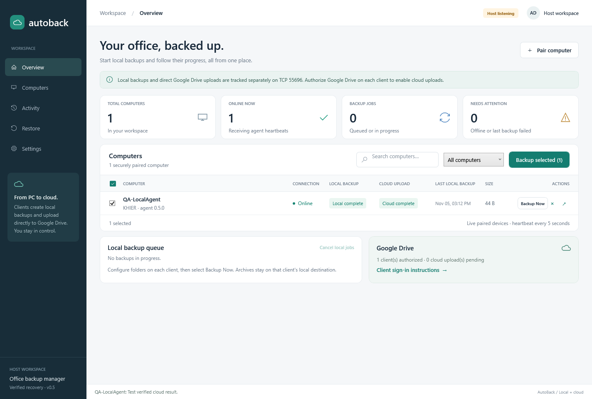

# AutoBack

A Windows host dashboard and background client agent for centrally controlled file and folder backups. Intended flow: **host → client command; client → Google Drive upload; client → host progress**.

## Current milestone: one incremental Drive folder per PC (v0.9.0)

Google Drive mode now keeps `AutoBack Backups/<PC name>/<source folder>/...` and sends only new/changed file contents. The same folder/file IDs are reused; removed source files stay in the backup. Missing/trashed destinations recover automatically. A verified recovery index supports folder restores, interrupted per-file uploads, encrypted contents and safe temporary cleanup. Historical folder jobs are marked superseded instead of offered as old restore points. Update both host and agent to v0.9.0/protocol 5; existing pairing and Google grants are retained. See [incremental Drive behavior, upgrade and test guide](docs/INCREMENTAL-DRIVE.md). This new format has automated simulated-Google validation; earlier live ZIP drills below do not validate it against a real Google account.

Version 0.8.3 fixes Windows error 5 when elevated setup cannot sign in directly as LocalService. A temporary Windows-started helper supplies the verified identity without assigning logon privileges. Administrator tests passed for both the modern and x86 Framework clients, including grants, independent rechecks, locked-file detection and helper cleanup; see `artifacts/service-identity-pilot-modern.json` and `artifacts/service-identity-pilot-legacy.json`. Actual Windows 7 remains a target-PC check.

Folder setup now includes **Check access** and **Grant required access**. Service-mode Save and service startup require a successful check using the worker identity; unreadable/locked/unsupported files are listed instead of silently skipped. Permission grants preserve unrelated ACLs and record original settings in a protected audit. See [folder access setup](docs/FOLDER-ACCESS.md).

Removed a client from the host? Use the new **Pair AutoBack Agent again** shortcut or the recovery option in Configure. Folders, Google sign-in, encryption keys and backup files are retained; previous jobs/uploads are protected and retired from automatic processing under the new identity. See [pairing recovery](docs/PAIRING-RECOVERY.md).

- An embedded host listener on TCP **47831**, active while the WPF host is open.
- A client agent that connects outbound and reports an authenticated heartbeat every **5 seconds**.
- Live paired-device inventory, last heartbeat, and online/offline transitions. A client is offline after **20 seconds** without a heartbeat.
- Single-use, five-minute pairing invitations, certificate-pinned TLS, per-agent credentials, and pairing revocation.
- Protected host/agent configuration, persistent device identity, automatic agent reconnection, and Windows Service support.
- Client-selected source/destination folders, host-triggered backups, real progress and errors, and cancellation.
- Google Drive keeps one current file tree and uploads new/changed files only. Local only keeps versioned ZIP/ABK archives. Both include empty folders and SHA-256 verification.
- Persistent host job history and client job journal, with idempotent delivery and interrupted-job recovery.
- Per-client Google Desktop OAuth/PKCE sign-in, DPAPI-protected refresh tokens, resumable direct uploads, retry checkpoints, and remote size/checksum verification.
- Independent local/cloud job results and a verified Drive link in the host's history. Cloud failure never rewrites a successful local result.
- Local ZIP and direct Google Drive recovery into a fresh folder, full file-set/SHA-256 readback, a saved restore report, and standalone re-verification.
- A Restore dashboard page with backup-specific client instructions and the latest authenticated recovery result per client.
- Persistent daily schedules in the host time zone, one missed-occurrence catch-up, offline queues and bounded local backup retries with immutable attempt history.
- Streaming AES-256-GCM `.abk` backups, DPAPI-protected client keys, password-protected recovery exports/imports and cross-client recovery.
- Opt-in local/cloud version retention with survivor verification, upload protection, exact managed-file pruning and confirmed Google Drive trashing.
- Self-contained host/agent Windows MSI installers, a client setup helper, service recovery configuration, package inspection and a physical-PC pilot checklist.
- A per-client folder manager with Add/Remove/Save, saved selections and up to 20 sources per PC. All subfolders are included; the host displays the complete reported list in computer details. Multi-folder archives retain separate source mappings and avoid duplicate-name collisions.
- New setup defaults to Google Drive with automatic temporary storage/verified cleanup; Local only saves permanent versions without automatic Google upload. Each job captures its destination policy and Google account binding. Existing plans/files are retained until deliberately reconfigured.
- A separate **Windows 7 SP1 32-bit legacy client** targets .NET Framework 4.8, shares the current backup/Drive logic, and connects to the same host over pinned TLS 1.2. [Legacy installer/setup and required Windows 7 pilot](docs/WINDOWS7-CLIENT.md). Actual x86 Framework process tests passed on the development PC; Windows 7 installation, service/reboot and real Google/browser checks are pending.

Use **[Destination modes](docs/DESTINATION-MODES.md)** and **[Choose backup folders per computer](docs/SELECT-FOLDERS.md)** for setup. With the MSI, open **Choose AutoBack backup folders** from Start Menu. With the portable client, run `AutoBack.Agent.exe configure`. Choose Google Drive (no permanent destination picker) or Local only (choose a local folder). [Google-mode preview](docs/google-drive-mode-preview.png) and [mode validation](artifacts/destination-validation/result.json).

There are no sample computers or simulated backups in the app. Existing clients retain their settings: schedules/retries start disabled, encryption is explicit and retention defaults to keeping everything. Plain `.zip` archives remain unencrypted; opt into `.abk` encryption with a verified recovery export. The host must remain open for scheduling. Google upload and restore were live-tested on November 5, 2026 using synthetic files. Windows Service installation, reboot/ACL checks and testing across multiple physical PCs remain pending; installers and the physical-PC test guide are prepared.

The same cloud backup also passed a **live download and restore drill on November 5, 2026** using the published v0.5 client: both synthetic files (239 payload bytes) recovered into a fresh folder, every SHA-256 matched the originals, standalone re-verification passed, and the actual restarted client reported completion to the paired host over TLS. Source files, the original archive and the backup configuration were unchanged. [Local validation evidence](artifacts/live-restore-test-1793862866092/result.json).

Version 0.6 passed a separate **live encrypted upload, retention and recovery drill**: a fresh isolated validation client uploaded two encrypted versions, retained the newest local/cloud version, pruned only its old synthetic local archive and moved only its old cloud object to Trash. A separate client data store imported its recovery export and downloaded/decrypted/restored both files (110 bytes), then passed re-verification. Original client settings and prior backups were preserved. [Live automation evidence](artifacts/live-automation-test-1793864952400/result.json).

The automated console pilot also ran **three real agent processes on one physical PC**, completed six daily scheduled backups, verified all three clients' recovery, and tested offline queuing/reconnect. [Local multi-client evidence](artifacts/automation-validation/multi-client-result.json). This does not claim multiple-PC or Windows Service validation.



## First run

For the prepared pilot installers, use `artifacts\installers\AutoBack-Host-0.9.0-win-x64.msi` and `AutoBack-Agent-0.9.0-win-x64.msi`. Verify the adjacent `SHA256SUMS.txt` and follow **[incremental Drive upgrade/test](docs/INCREMENTAL-DRIVE.md)** and **[physical-PC rollout checklist](docs/ROLLOUT-CHECKLIST.md)**. The agent MSI starts stopped/manual; its setup helper pairs/configures the client and enables automatic startup after source access is ready. Google mode manages staging permissions; Local only also needs destination access. Console-mode development instructions follow.

For a Windows 7 SP1 x86 client, use **`AutoBack-Agent-Legacy-0.9.0-win-x86.msi`**, install Framework 4.8 first, then follow the [legacy guide](docs/WINDOWS7-CLIENT.md). The host stays on modern Windows. The legacy setup shortcut is native and does not require a PowerShell upgrade.

On the host, open `AutoBack.slnx` in Visual Studio and run the **AutoBack** project, or:

```powershell
dotnet run --project AutoBack.csproj -c Release
```

Close any older demo window before rebuilding/running that same executable. Click **Pair computer**, enter the host's reachable computer name or IPv4 address, and save an invitation. For an initial test on this PC, use `127.0.0.1`.

Publish the client agent:

```powershell
dotnet publish src/AutoBack.Agent/AutoBack.Agent.csproj -c Release -r win-x64 --self-contained true -o artifacts/agent-win-x64
```

Copy the **entire** published folder to the client, together with its invitation, and run:

```powershell
.\AutoBack.Agent.exe pair --invite .\client.autoback-invite
.\AutoBack.Agent.exe configure
.\AutoBack.Agent.exe drive-connect
.\AutoBack.Agent.exe run
```

`configure` opens the client folder manager: choose Google Drive (default) or Local only, add sources and Save folders. Pick a permanent destination only for Local only. All subfolders are included. Google mode requires sign-in; Local only skips it. Once the running client's configuration appears in the host, click **Backup Now** or **Backup selected**. The published agent does not require the .NET SDK on the client.

See **[connection setup](docs/CONNECTION-SETUP.md)** for LAN/firewall setup, automatic Windows Service startup, re-pairing, and troubleshooting.
See **[destination modes](docs/DESTINATION-MODES.md)**, **[local backup setup](docs/LOCAL-BACKUP.md)** and **[Google Drive setup](docs/GOOGLE-DRIVE-SETUP.md)**. Update **both host and agent** to version 0.9.0 (protocol 5). Saved pairing credentials/certificates are reused; old invitation files must be regenerated. Local-only records use a separate journal to prevent old agents from rediscovering them for upload. Archive formats 1/2 and recovery exports remain compatible; the new Drive file-tree index is separate from those archive formats.

For recovery, open **Restore** on the host for the selected backup's instructions. Stop the client agent, then run the appropriate command in its published folder:

```powershell
.\AutoBack.Agent.exe restore
.\AutoBack.Agent.exe restore --drive-file 'GOOGLE_FILE_ID'
.\AutoBack.Agent.exe verify-restore
.\AutoBack.Agent.exe run
```

The pickers select an archive/parent folder or an existing recovery folder for verification. Recovered source content is under `<new destination>\files`, with manifest and report alongside it. Restart the agent to send its saved result to the host. See **[restore guide](docs/RESTORE.md)** for explicit paths, failure handling, service scope, and verification limits.

## Verification

Requires Windows and the .NET 10 SDK. These are executable integration checks, run with `dotnet run` rather than `dotnet test`:

```powershell
dotnet build AutoBack.slnx -c Release
dotnet run --project tests/AutoBack.Connection.Tests/AutoBack.Connection.Tests.csproj -c Release
dotnet run --project tests/AutoBack.Backup.Tests/AutoBack.Backup.Tests.csproj -c Release
dotnet run --project tests/AutoBack.Drive.Tests/AutoBack.Drive.Tests.csproj -c Release
dotnet run --project tests/AutoBack.Restore.Tests/AutoBack.Restore.Tests.csproj -c Release
dotnet run --project tests/AutoBack.Automation.Tests/AutoBack.Automation.Tests.csproj -c Release
dotnet run --project tests/AutoBack.Folders.Tests/AutoBack.Folders.Tests.csproj -c Release
dotnet run --project tests/AutoBack.Destinations.Tests/AutoBack.Destinations.Tests.csproj -c Release
dotnet run --project tests/AutoBack.Desktop.Tests/AutoBack.Desktop.Tests.csproj -c Release
.\tests\AutoBack.Legacy.UnitTests\bin\Release\net48\AutoBack.Legacy.UnitTests.exe
dotnet run --project tests/AutoBack.Legacy.IntegrationTests -c Release
dotnet run --project tests/AutoBack.Pairing.Tests -c Release
dotnet run --project tests/AutoBack.Access.Tests -c Release
```

The connection suite uses real TLS sockets and an actual agent subprocess. It checks invitation replay/expiry/cancellation, concurrent pairing, rejected credentials and pins, timeouts, host restart, revocation, protected storage, malformed frames, and reconnect. The backup suite checks real archive contents/checksums, version preservation, locked/changed files, cancellation, cleanup, job replay, interrupted recovery, and a host-triggered backup using the actual agent executable. The desktop suite exercises the real Backup action and job results in WPF, including the 20-second offline transition, and refreshes screenshots. All use isolated temporary data and loopback ports.

The Drive suite simulates Google's HTTP API while using real local ZIPs and real authenticated host connections. It tests PKCE/state, protected OAuth storage, invalid refresh grants, 401 refresh, resume/restart, expired sessions, quota/rate-limit errors, checksum mismatch, endpoint validation, file-ID deduplication, and separate local/cloud results. It does not contact or modify a live Google account.

The restore suite exercises real archives, file/directory recovery, independent readback, modified/missing/extra files, no-overwrite and publication races, path traversal/collisions, link entries, format/size limits, cancellation cleanup, authenticated downloads and failure scenarios using simulated Google HTTP, actual CLI commands, protected journals, interrupted recovery, and TLS reporting. The desktop suite also validates recovery navigation and instructions with a real local restore.

The automation suite checks streaming encryption, header/chunk/footer tampering, truncation/order changes, wrong/missing recovery keys, portable export/import, local/cloud retention boundaries, changed survivor protection, encrypted upload/download with simulated Google HTTP, persisted schedules, DST/catch-up, bounded retries, immutable expiration reports and the actual three-client console pilot. Desktop checks cover saved automation and client protection/expiration status. Package checks inspect the built MSI databases, checksums, credential exclusions and service configuration without installing the product.

The folders suite exercises the real Windows Forms folder manager and CLI, 1–20 independent sources, duplicate/overlap/missing-root rejection, saved selections/cancellation, legacy compatibility, format-2 mapping/readback, encrypted Drive roundtrips with simulated HTTP, retention and an actual host-triggered multi-folder backup. Desktop checks also validate folder counts and the full source list in computer details.

The destinations suite covers default cloud setup, explicit local-only isolation with connected credentials, preflight sign-in, account-bound temporary cleanup after host acknowledgment, remote rechecks, failed-upload/restart preservation, migration and real process mode changes. All eight suites pass in Release. A separate published-agent live drill uploaded an encrypted two-source backup, automatically removed the temporary archive, switched to Local only without creating another upload and restored the cloud copy after cleanup. [Live mode evidence](artifacts/live-destination-test-1793920813038/result.json).

```powershell
.\scripts\Build-Installers.ps1
.\scripts\Test-InstallerPackages.ps1
```

Machine-wide DPAPI roundtrips and Windows Service installation need an elevated account. In a normal terminal the suite verifies that machine mode is rejected **before** altering directory permissions. The scripts can be syntax-checked without elevation; installation must be exercised separately on a client with administrator access.

## Milestone status

1. **Host–agent connection (implemented):** pairing, heartbeats, real inventory, reconnect, and revocation.
2. **Local backup (implemented):** per-client multi-folder selection, versioned ZIPs/manifests, persisted jobs, acknowledgements, cancellation, verification, and actual progress/errors.
3. **Direct Google Drive upload (implemented; live console test verified):** client authorization, protected tokens, resumable upload, retries, remote result verification, and separate local/cloud status. One upload per client; office-wide upload slots remain rollout work.
4. **Restore verification (implemented; live console drill verified):** local/Drive recovery to a fresh folder, manifest and SHA-256 verification, standalone recheck, protected history, and authenticated dashboard results.
5. **Automation and deployment (implemented; physical rollout pending):** persisted schedules/retries, recoverable encryption, opt-in retention, built/inspected Windows MSIs, service setup/recovery and an executable readiness check plus physical-PC pilot guide. Live encrypted cloud retention/recovery and a three-process single-PC pilot passed. MSI install/upgrade/uninstall, service reboot/permissions and multi-physical-PC tests require the target environment.

The backup engine covers ordinary local files/folders. It fails on inaccessible/locked files, detected source changes, and symbolic links/junctions. It is not a filesystem snapshot; live databases and full Windows images need a separate design.

## Source layout

- `MainWindow.xaml`, `DashboardViewModel.cs`: WPF host dashboard and live inventory.
- `AddComputerWindow.xaml`: invitation export and client instructions.
- `src/AutoBack.Connection`: framed TLS protocol, pairing registry, host scheduler/retries, host identity, DPAPI storage, and agent transport.
- `src/AutoBack.Agent`: console pairing/status/restore commands and Windows Service worker.
- `src/AutoBack.Backup`: folder validation, ZIP creation, streaming encryption/recovery keys, local retention, restore/readback, and durable client journals.
- `src/AutoBack.Drive`: Desktop OAuth/PKCE, token refresh, resumable Drive API uploads, verified downloads, and protected cloud job checkpoints.
- `scripts`: installer build/inspection, client setup/readiness, legacy service registration/removal and opt-in host firewall setup.
- `tests`: connection, local backup, Drive, restore, automation/multi-client and desktop integration checks.

Host identity and devices are saved under `%LOCALAPPDATA%\AutoBack\Host`, protected for the current Windows account. Console agent credentials use `%LOCALAPPDATA%\AutoBack\Agent`; service credentials use `%PROGRAMDATA%\AutoBack\Agent` with machine DPAPI and a restricted ACL. Do not commit invitation files or credential stores.

Implementation references: [Microsoft Windows Service worker guidance](https://learn.microsoft.com/en-us/dotnet/core/extensions/windows-service), [SslStream/TLS guidance](https://learn.microsoft.com/en-us/dotnet/core/extensions/sslstream-best-practices), and [Windows DPAPI scope](https://learn.microsoft.com/en-us/dotnet/api/system.security.cryptography.dataprotectionscope).
